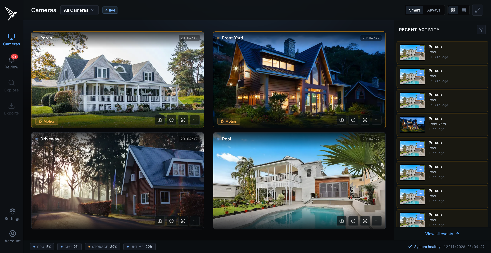
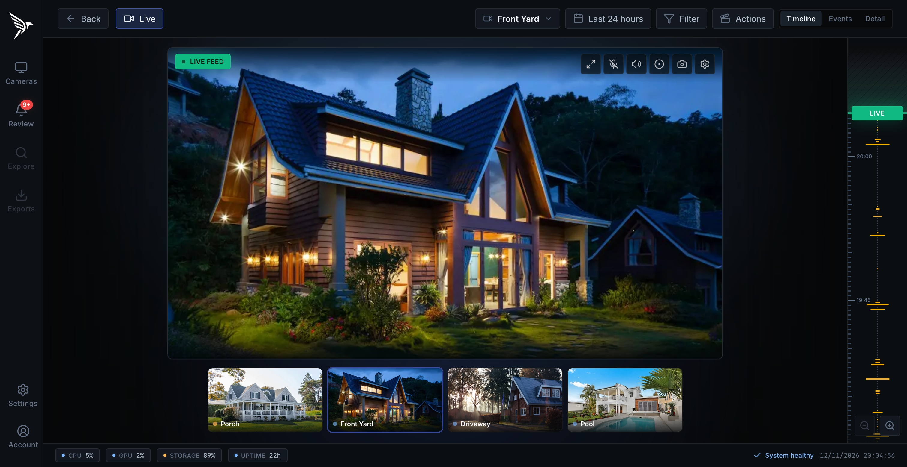
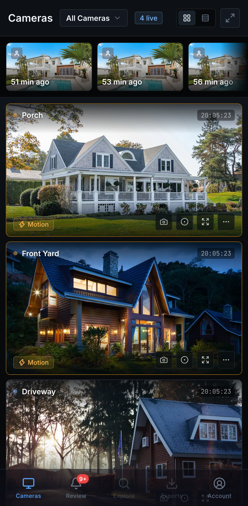
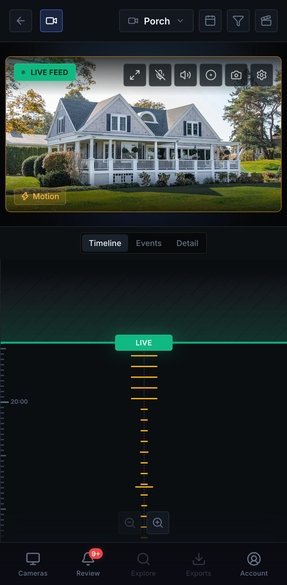

# Frigate Vue

A redesign of the [Frigate NVR](https://github.com/blakeblackshear/frigate) web UI, rebuilt in Vue 3 with TypeScript and plain modern CSS.

Only the frontend in `web/` changes. The backend is upstream Frigate (0.19 dev), so the new UI runs against a normal Frigate install and uses the same config, database and recordings.

> This is a work in progress and not an official Frigate project. See [`web/TODO.md`](web/TODO.md) for what is done and what is still to be ported.





<p>
  
  
</p>

## What's different

- **One camera view for live and review.** Live, recordings and the scrub preview sit on a single stage, with the timeline beside it. Drag the playhead back to review footage, then release at the top or press `L` to return to live. Opening an alert or detection takes you to the same view at that moment.
- **No black frames when switching.** The current frame stays on screen until the next source has drawn its first frame. The stage keeps a fixed size, so the layout does not shift.
- **Fast handoffs.** Live stays connected for a short time after you scrub away, so going back to live resumes instead of reconnecting. Recordings are loaded in advance, so the first scrub back is just a seek.
- **Page transitions.** A camera tile expands into the camera view using the View Transitions API and keeps its live stream, so nothing reloads.
- **Smart dashboard.** Tiles show a still image until there is activity, then switch to live. The grid sizes itself so every camera fits on screen. The recent activity panel becomes a thumbnail strip on smaller screens.
- **Mobile first.** The sidebar becomes a bottom tab bar on phones, and the timeline sits under the stage.
- **Lighter stack.** Uses Vue 3 and plain scoped CSS with design tokens. It has no CSS framework, UI kit or chart library.

## Running with Docker

### Option 1: Mount the UI into an existing Frigate container

This is the quickest option. Build the frontend once:

```bash
cd web
npm install
npm run build
rm -rf dist/BASE_PATH
```

Then mount `web/dist` over the bundled UI in your Frigate container:

```yaml
services:
  frigate:
    image: ghcr.io/blakeblackshear/frigate:<0.19 dev tag>
    volumes:
      - ./config:/config
      - ./storage:/media/frigate
      - /path/to/frigate-vue/web/dist:/opt/frigate/web:ro
    ports:
      - "8971:8971"
      - "8554:8554"
      - "8555:8555/tcp"
      - "8555:8555/udp"
```

Restart the container and open `https://<host>:8971`. To go back to the stock UI, remove the volume line.

Because the UI talks to the 0.19 API, use a 0.19 dev image. Older releases may be missing endpoints.

### Option 2: Build the full image

This builds Frigate with the new UI baked in, using the upstream Dockerfile:

```bash
make local   # produces frigate:latest
make run     # runs it with ./config mounted, on ports 5000 and 8971
```

Then use `frigate:latest` as the `image` in your compose file.

## Developing the UI

You can run the dev server against any Frigate instance. No Docker is needed:

```bash
cd web
npm install
PROXY_HOST=<frigate-ip>:5000 npm run dev
```

Port 5000 is Frigate's internal, unauthenticated port, so it must be published from the container. On macOS, port 5000 is taken by AirPlay, so point at the Frigate host explicitly. For checks, tests and the project layout, see [`web/README.md`](web/README.md).

## License

MIT, as upstream. See [LICENSE](LICENSE). "Frigate" and the Frigate logo are trademarks of Frigate, Inc. See [TRADEMARK.md](TRADEMARK.md).
